<h1 align="center">👋 Hello, I am Marcos Vinicius</h1>

  <b>Artificial Intelligence Specialist • Data Scientist • IT Analyst</b>

  💼 IT Professional with <b>15+ years of experience</b> in mission-critical Information Technology environments, where stability, precision, and agile problem-solving are baseline requirements.

  🎯 Currently in a strategic transition to <b>Data Science and Artificial Intelligence</b>, combining extensive enterprise experience with strong academic training to build end-to-end architectures that solve real-world problems.

  <i>Accurate analysis ➔ Robust modeling ➔ Agile decisions.</i>

  🌐 <b>Complete Portfolio:</b> <a href="https://mvdatascience.ia.br" target="_blank">https://mvdatascience.ia.br</a>

---

### 👨‍💻 Featured Projects

- 🤖 **End-to-End RAG & Autonomous Agents:** Multi-agent system and Retrieval-Augmented Generation built with LLMs, LangChain, LangGraph, Vector Databases, and FastAPI.
- 🛡️ **LOG AI — Anomaly Detection & Explainability:** Hybrid log ingestion and anomaly detection pipeline applying Isolation Forest and SHAP explainability.
- 🔥 **Wildfire Prediction in Brazil:** End-to-end geospatial analysis and machine learning pipeline using INPE data, SQL, and XGBoost.
- 🚦 **Traffic Sign Detection & Classification:** Computer Vision pipeline using HOG, SVM, and Convolutional Neural Networks (CNNs) for autonomous scenarios.
- 💳 **Credit Risk & Default Prediction:** Credit scoring models built with Random Forest and Artificial Neural Networks (ANNs) to support loss mitigation.
- 📊 **Retail Sales Clustering & Forecasting:** Unsupervised learning (K-Means & PCA) and Time Series forecasting to identify consumption patterns and optimize inventory.

---

### 🧠 Education & Certifications

- 🤖 **Specialization in Artificial Intelligence and Data Science** — Universidade Federal do Espírito Santo (UFES)
- 📈 **MBA in Big Data and Competitive Intelligence** — Uniamérica
- 📊 **Postgraduate Degree in Data Science** — Uniamérica
- 🎓 **Technologist in Systems Analysis and Development** — Centro Universitário São Camilo
- 🏅 **Certifications:** Google Data Analytics • Prompt Engineering Foundation • Business Intelligence Foundation (BIFPC™) • LGPD Fundamentals

---

### 🧰 Technologies and Tools

  
  
  
  
  
  
  
  
  
  
  
  
  
  

---

### 📊 GitHub Stats & Trophies

  
    
  
  

---

  <picture>
    <source media="(prefers-color-scheme: dark)" srcset="https://githubusercontent.com">
    <source media="(prefers-color-scheme: light)" srcset="https://githubusercontent.com">
    
  </picture>

---

### 📫 Connect with Me

  
  
  

